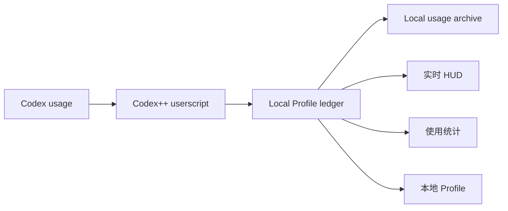

# Codex Token Cost

<p align="center">
  <strong>Codex++ 本地 Token、费用与使用趋势面板</strong><br>
<sub>实时 HUD、本地 Profile、模型定价，数据始终留在本机。</sub>
</p>

<p align="center">
  <code>v0.7.9-beta1</code>
  &nbsp;·&nbsp;
  <code>Windows / macOS</code>
  &nbsp;·&nbsp;
  <code>Local-first</code>
  &nbsp;·&nbsp;
  <code>Codex++ UserScript</code>
</p>


Codex Token Cost 是一个面向 [Codex++](https://github.com/BigPizzaV3/CodexPlusPlus) 的本地 userscript。它在 Codex 输入区上方展示本轮、当前会话、缓存命中、费用和今日累计，并提供独立使用统计、模型价格管理及本地 Profile 数据。

主脚本独立运行，历史使用记录以 userscript 本地 Profile ledger / archive 为准。

## 核心能力

| 能力 | 说明 |
|---|---|
| 实时 HUD | 展示本轮输入/输出、会话累计、缓存命中、会话费用和今日费用 |
| 使用统计 | 支持今日、7 天、30 天和自定义日期范围，提供趋势、环比、Token 构成和模型筛选 |
| 本地 Profile | 解锁 Codex Profile，并使用本地 Profile ledger 替代不可用的云端资料 |
| 模型定价 | 按 USD / 1M tokens 管理输入、读缓存、写缓存和输出价格 |
| 历史使用记录 | 由本地 Profile ledger 与 archive 提供，覆盖 HUD、Profile 和使用统计 |
| 本地优先 | usage、价格和 Profile 配置保存在本机，不上传项目内容或认证信息 |

## 功能展示

### 使用统计

统一复用 HUD、Profile 与本地 ledger 的去重口径。支持 Token / 花费切换、时间范围筛选、模型联动和缓存命中分析。


### 本地 Profile

解锁 Codex 个人 Profile，展示本地累计 Token、活跃热力图、连续使用天数、推理强度以及 skill / plugin 使用情况。


### 模型价格

内置常用模型价格，并允许为新模型添加或覆盖本地定价。缓存读取和缓存写入分别计价。


### 数据与显示

HUD 可随时关闭；所有历史记录来自 userscript 本地捕获，不影响基础统计。

“启用本地 Profile 解锁”默认开启，以保持既有行为。若不需要本地 Profile，可以在“数据与显示”中关闭；脚本会立即停止资料伪装和 Profile 专属补丁，同时保留 Token、费用、HUD 与使用统计。由于 Codex 内部页面可能已经加载，切换后如界面未完全恢复或解锁，请重启 Codex。


## 工作方式



## 快速安装

### Windows

```powershell
powershell -NoProfile -ExecutionPolicy Bypass -File .\scripts\deploy-userscript.ps1
```

### macOS

```sh
sh ./scripts/deploy-userscript.sh
```

安装后重启 Codex，或重新加载 Codex++ 用户脚本。

## 项目结构

```text
scripts/
  codex-live-token-cost.js          Codex++ 主脚本
  deploy-userscript.ps1             Windows 部署脚本
  deploy-userscript.sh              macOS 部署脚本
tests/
  codex-live-token-cost.test.cjs
```

## 环境要求

- Codex 桌面端
- Codex++
- Windows 或 macOS

## 隐私

- 主脚本写入 Codex WebView 的 `localStorage`，并在可用时使用 IndexedDB 保存 Profile ledger。
- 仓库不保存 API key、cookie、session token 或真实云端账号 ID。
