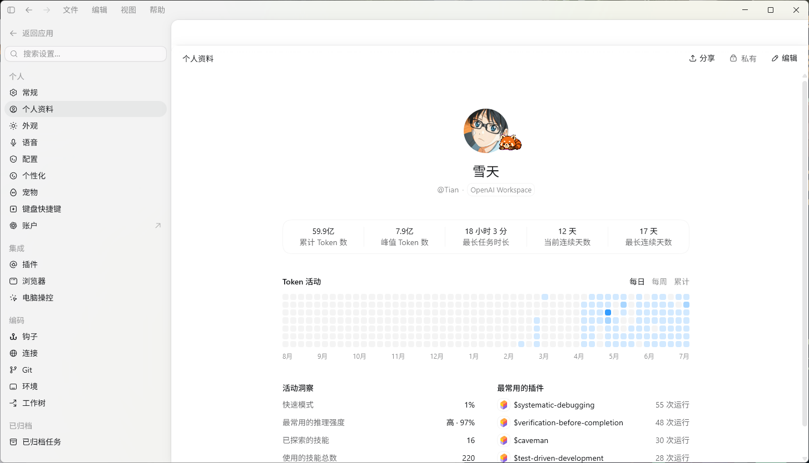
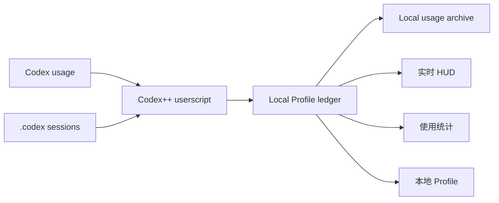

# Codex Token Cost

<p align="center">
  <strong>Codex++ 本地 Token、费用与使用趋势面板</strong><br>
<sub>实时 HUD、本地 Profile、模型定价，数据始终留在本机。</sub>
</p>

<p align="center">
  <code>v0.8.1</code>
  &nbsp;·&nbsp;
  <code>Windows / macOS</code>
  &nbsp;·&nbsp;
  <code>Local-first</code>
  &nbsp;·&nbsp;
  <code>Codex++ UserScript</code>
</p>


Codex Token Cost 是一个面向 [Codex++](https://github.com/BigPizzaV3/CodexPlusPlus) 的本地 userscript。它在 Codex 输入区上方展示本轮、当前会话、缓存命中、费用和今日累计，并提供独立使用统计、模型价格管理与本地 Profile 数据。

主脚本独立运行，历史使用记录以本地 Profile ledger / archive 为准；脚本会自动读取本机 Codex 会话文件回填缺失用量，全程在本机完成。

## 核心能力

| 能力 | 说明 |
|---|---|
| 实时 HUD | 展示本轮输入/输出、会话累计、缓存命中、会话费用和今日费用，可单独开关输出速率 |
| 使用统计 | 支持今日、7 天、30 天和自定义日期范围，提供 KPI 环比、趋势、Token 构成和模型筛选 |
| 本地 Profile | 真实 ChatGPT 登录后，用本地 ledger 覆盖 Profile 用量与账号菜单显示；纯 API Key 下不伪造资料页 |
| 模型定价 | 按 USD / 1M tokens 管理输入、读缓存、写缓存和输出价格，支持搜索、来源筛选与自定义模型 |
| 历史使用记录 | 由本地 Profile ledger 与 archive 提供，覆盖 HUD、Profile 和使用统计 |
| 自动回填 | 静默读取本机 `.codex` 会话记录，增量导入缺失用量，重复同步不会重复计数 |
| 本地优先 | usage、价格和 Profile 配置保存在本机，不上传项目内容或认证信息 |

## 功能展示

### 使用统计

统一复用 HUD、Profile 与本地 ledger 的去重口径。支持 Token / 花费切换、今日 / 7 天 / 30 天 / 自定义范围、KPI 环比、趋势与 Token 构成，以及模型联动和缓存命中分析。


### 本地 Profile

在真实 ChatGPT 登录下用本地累计 Token、活跃热力图、连续使用天数、推理强度以及 skill / plugin 使用情况覆盖 Profile 展示。

纯 API Key 登录时，Codex 本身不提供个人资料页；脚本不再伪造登录态或资料接口，只保留 HUD、费用与本地统计。



### 模型价格

价格唯一来源为 LiteLLM 上游价格表，通过 Codex++ 本地通道同步并缓存到本机；启动时优先读取本地缓存，上游失败也不会丢价。默认列出官方在售的 gpt 模型（5.4 及以上），其余模型在使用后出现。

列表支持搜索与官方 / 自定义筛选，右侧编辑器可新增或覆盖单个模型的价格，缓存读取和缓存写入分别计价。


### 常规

HUD 与输出速率可随时关闭；所有历史记录来自本地捕获，不影响基础统计。

「历史数据同步」会在启动后自动运行，并按固定间隔增量扫描会话文件，状态行显示写入 / 去重 / 跳过轮数与覆盖范围。也可随时点「立即同步」手动触发；本地通道不可用时回退到选择 `.codex` 文件夹。

「本地账本」逐条保存每次模型调用的响应级用量，提供四个按钮：**备份到主机**（写入 `.codex/usage-ledger/`，超过 30 天的分片转为只读归档）、**导出**（可自己选保存位置和文件名）、**导入**（按 response_id 合并，不整库覆盖）、**重建统计**（重算 turn 投影与派生统计，不动原始事实）。

「本地资料」开关只影响 Profile 展示。关闭后脚本立即停止本地数据覆盖，并恢复官方姓名、头像与菜单，同时保留 Token、费用、HUD 与使用统计。


## 工作方式



## 快速安装

### Windows

```powershell
powershell -NoProfile -ExecutionPolicy Bypass -File .\scripts\deploy-userscript.ps1
```

### macOS

```sh
sh ./scripts/deploy-userscript.sh
```

安装后重启 Codex，或重新加载 Codex++ 用户脚本。

设置页标题旁会显示当前版本：点击版本号可检查更新，发现新版后可直接「一键更新」并就地生效。

## 项目结构

```text
scripts/
  codex-live-token-cost.js          Codex++ 主脚本
  codex-live-token-cost-reload.cjs  CDP 热重载辅助
  codex-usage-backfill.cjs          会话记录扫描与回填
  deploy-userscript.ps1             Windows 部署脚本
  deploy-userscript.sh              macOS 部署脚本
tests/
  codex-live-token-cost.test.cjs
  codex-live-token-cost-reload.test.cjs
  codex-live-token-cost-backfill.test.cjs
  codex-live-token-cost-idb.test.cjs
```

## 环境要求

- Codex 桌面端
- Codex++
- Windows 或 macOS
- Node.js 22+（运行测试与回填脚本需要；Windows 沙箱出现 Schannel 凭证错误时，也用于备用下载）

## 兼容性验证

当前版本 `v0.8.1` 已在以下环境实测通过：

| 环境 | 版本 |
|---|---|
| Codex 桌面端（Windows） | `26.1013.4894.0` |
| Codex++ | `1.10.0` |
| 操作系统 | Windows 11 26H2（build 26300） |

macOS 尚未验证。其它 Codex / Codex++ 版本可能有选择器或接口差异，遇到问题请附上两个版本号。

## 更新日志

### v0.8.1

- **导出可以自己选位置**：优先 `showSaveFilePicker` 选具体文件和目录，其次 `showDirectoryPicker` 选文件夹，宿主都没开放时才回退浏览器下载。选好位置后写入失败会明确报错，不会悄悄改成下载到别处。
- **本地账本四个按钮现在都有反馈**：备份 / 导出 / 导入 / 重建都会在状态行给出结果或失败原因；导出中途取消会显示「已取消导出」。导入对话框取消不再让按钮卡死。
- **导入写完才回报成功**：导入会等数据真正落到 IndexedDB 才提示成功，写入失败时明确告诉你「数据仅存在于本次会话内存中」。
- **修掉导出文件类型标错**：JSON 导出的 MIME 以前固定写成 NDJSON，现在跟随实际格式。
- **修掉「重建统计」名不符实**：现在会重算 turn 投影和派生统计，不再只刷界面。
- **自动备份接上了线**：新事实落盘后 8 秒防抖自动写主机冷备，不用再手动点。
- **同步入库不再假成功**：历史同步等事实真正入库才报「写入 N 轮」，失败时状态行会追加「事实入库失败（仅内存，刷新后丢失）」。
- **口径统一**：导出与主机备份改用权威口径，不再把已被取代的 legacy 记录算进去，导出的条数/总量与面板显示一致。
- **单文件模块化**：主脚本保持单文件，内部按 24 个模块划分并加了模块地图，无状态工具收进 `UTIL` 命名空间。
- **兜底**：新增 `unhandledrejection` 记账，异步动作失败不再完全静默。
- **Windows 价格同步修复**（[@gjk-777](https://github.com/gjk-777)，[PR #10](https://github.com/Tianzora/codex-token-cost/pull/10)）：默认命令沙箱禁止联网、Windows Schannel 报 `SEC_E_NO_CREDENTIALS` 导致价格同步失败。现在只为下载单条命令开联网并限定用户脚本目录写入，且在 curl 退出码 35 时改用 Node 备用下载（保留证书校验、重定向、Range 与超时）。

## 隐私

- 主脚本写入 Codex WebView 的 `localStorage`，并在可用时使用 IndexedDB 保存 Profile ledger。
- 价格缓存保存在 Codex++ 用户脚本目录下的 `.prices.cache.json`，历史同步只读取本机 `.codex` 会话文件。
- 外部请求仅用于拉取 LiteLLM 价格表与检查脚本更新。
- 仓库不保存 API key、cookie、session token 或真实云端账号 ID。
